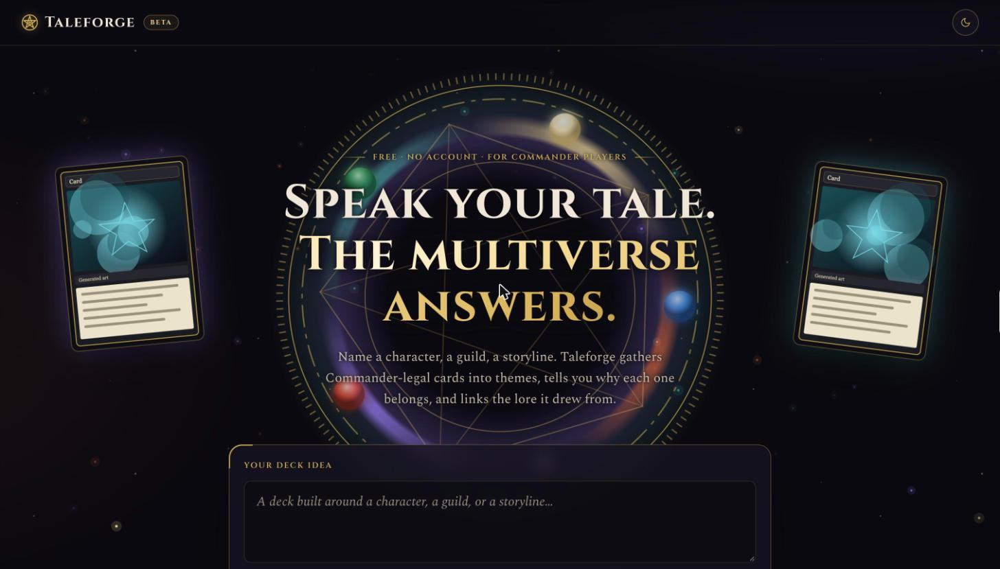
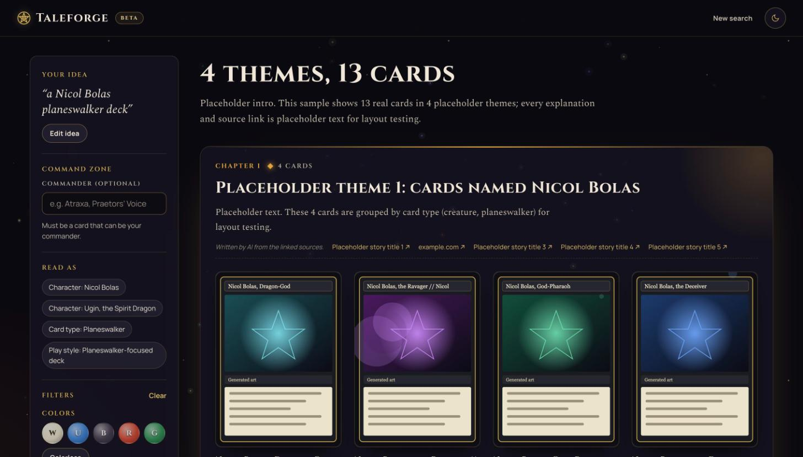
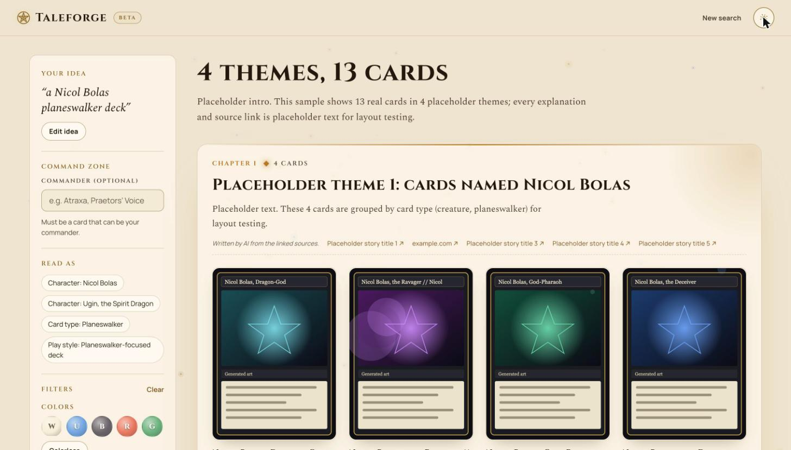

# Taleforge

**Describe a Magic: The Gathering Commander deck idea. Get cards that fit it, grouped by theme, each with a short explanation and a link to the story it came from.**

Taleforge is a free website for Commander players who build around a story instead of a stat line. Type "a deck about Liliana's betrayal of Bolas" or "a War of the Spark rivalry deck" and it finds Commander-legal cards that tie to that character, guild or storyline, and tells you why each one belongs.



## What you get

- **Ideas, not card names.** Name a character, a guild, a storyline, or a feeling like "patient and cruel".
- **Cards grouped by theme.** Up to 30 cards in themed groups, each with a short written reason and links to its Scryfall page and the lore article behind it.
- **Lore and Synergy tags.** A card is tagged Lore when it ties to your story and Synergy when real decks play it with the cards you named. One slider changes how much each counts.
- **Command zone and filters.** Pick a commander to limit the results to its colors, or filter by color and card type.
- **Light and dark themes.** Obsidian and parchment.
- **No account, no payment, no email.**

| Results, dark "obsidian" | Results, light "parchment" |
|---|---|
|  |  |

Screenshots come from the mock server, so the text and source links on them are placeholders and the card images are generated.

## Free searches and your own OpenAI key

Searches cost real money, so the free tier is limited: **5 searches per visitor per day**, inside a small daily total for the whole site. Repeat searches are cached and cost nothing.

Want more? Open "Your own OpenAI key" on the home page (or on the "daily limit" page) and paste an OpenAI API key. Then:

- Searches have **no daily limit**. OpenAI bills your account, about a cent per search.
- The key stays **in your browser** and is sent with each search to be used once. Taleforge never stores or logs it.
- Remove it any time with the Remove button.

## Your privacy

Your idea is sent to OpenAI to read it and write the explanations. Taleforge doesn't save it: the server logs only the time, cost and duration of each search.

*Taleforge is unofficial Fan Content permitted under the Fan Content Policy. Not approved/endorsed by Wizards. Portions of the materials used are property of Wizards of the Coast. ©Wizards of the Coast LLC.*

---

# For contributors

This repository holds only the website: pages, styles, scripts and design references. The search engine lives somewhere else. A small mock server stands in for it here and answers every search with placeholder data, so you can work on the site without the engine.

## Run it

You need Python 3, which macOS already includes. In Terminal:

```
git clone <repository URL> taleforge-web && cd taleforge-web
python3 mock_server.py
open http://127.0.0.1:8000
```

Press Ctrl+C in Terminal to stop the server.

## What is where

| Path | What it is |
|---|---|
| `index.html` | Home page (the search box) |
| `results.html` | Results page |
| `compare.html` | Puts the two dark tones side by side |
| `v-lifted/`, `v-blackout/` | Static previews of the two dark tones, with their own `app.css` |
| `app.css` | Styles for the home and results pages (own tokens, dark "obsidian" and light "parchment") |
| `fx.js` | Decorative motion: rising embers canvas and the foil tilt on card art; off under reduced motion |
| `fonts/` | Self-hosted Cinzel, Spectral and Manrope (SIL Open Font License) |
| `app.js` | Results page behaviour: runs the search and shows each step as it arrives |
| `filters.js` | The filter chips (colors, card types), the "Command zone" commander box, and their URL and request helpers, used by both pages |
| `key.js` | The optional "your own OpenAI key" field: stored in `localStorage`, sent as the `X-OpenAI-Key` header |
| `footer.js` | Footer on every page: privacy line, disclaimer, credits |
| `theme.js` | Light/dark switch (the tone switch is only used by the `v-*` previews) |
| `sample_result.js` | Placeholder search result used by the static previews |
| `disclaimer.txt` | The footer disclaimer, word for word |
| `design/`, `design-dark/`, `design-blackout/` | Reference exports from Claude Design: the design system (`_ds/`, colour, type and spacing tokens) and the full design file `Taleforge.dc.html`. Not shipped. |
| `API.md` | The contract between the site and the search engine |
| `mock_server.py`, `fixtures/` | The mock search server and the placeholder answers it sends |
| `tests/` | Checks that the placeholder answers match `API.md` |

## Try every state

On the home page, type an idea that contains one of these words, then search:

| Word in the idea | What you see |
|---|---|
| (none) | Normal results, arriving step by step |
| `slow` | Normal results, with long pauses so you can study the loading states |
| `empty` | The "no matches" page |
| `limit` | The "daily limit reached" page (with an own key saved, the limit is skipped; add `badkey` to see the "key not accepted" page) |
| `paused` | The "search is paused" page |
| `error` | The search starts, then fails partway through |

For example, "a slow Bolas deck" or "show me the empty state".

### Filters

Both pages have the same filter chips: colors (W U B R G and Colorless; Colorless clears the others and picking a color clears Colorless) and card types. On the home page they sit under "Filters (optional)". On the results page they are in the sidebar and apply on their own: 1.5 seconds after your last chip click or Clear click, any search still running is cancelled and one new search starts (none if the filters ended up as they were). The Update button is only under the Mix; it also applies any filter or commander change still waiting.

The commander is not a filter. It has its own "Command zone" box on both pages, directly under the idea box, with a "Commander (optional)" field and the note "Must be a card that can be your commander." The field does not search while you type: it applies when you press Enter or leave the field, and only if its text changed since the last search; a chip wait still pending is applied together with it. On the home page it is sent with Find cards. The "Clear" button in Filters does not touch it. When a commander is found, the results page shows it above the results under the label "Command zone" (the `commander_card` from `API.md`).

Everything is kept in the address as `colors=W,U` (or `colors=C`), `types=Creature,Instant` and `commander=Name`, sent as `colors`, `types` and `commander` per `API.md`, and shown as "Filter ·" chips under "Read as".

The mock applies them to the 13 fixture cards, the way the real server filters before it picks the best 30:

| Filter | What the mock does |
|---|---|
| colors | A card's color identity must be inside the chosen colors. Colorless cards always pass. Colorless alone keeps only colorless cards (Ugin). |
| types | A card must have at least one of the chosen types. |
| commander | The commander is removed. If it is one of the fixture cards (for example `Nicol Bolas, Dragon-God`, or the front face `Nicol Bolas, the Ravager`), the answer has `commander_card` and the results page shows it above the results (whole card image, name, color identity, Scryfall link); if no colors are chosen, its colors become the allowed colors. Any other name is accepted, changes nothing and gets no `commander_card`, so no commander block shows. |
| commander, fixture card that cannot lead | 400 `not_a_commander` (for example `Nicol Bolas, Dragon-God`, `Ugin, the Spirit Dragon`, any planeswalker here): the "That card can't be a commander" page. Only `Nicol Bolas, the Ravager` is eligible (`commander_eligible` in `fixtures/cards.json`, a mock-only field the mock never sends). |
| commander `unknown` | 400 `unknown_commander`: the "commander not found" page. |
| bad values | 400 `bad_request`. |
| nothing left | The "no matches" page. Groups that lose all their cards disappear. |

Cards show a Lore tag, a Synergy tag, both side by side, or no tag, from their `evidence` list. One fixture card has an empty list (no tag). Every search returns the same placeholder result. Its card names, images and Scryfall links are real, and all text and source links are placeholders. One card has five sources (to show "+N more"), and two cards are in no theme (to show "More cards").

## Send me changes

1. Make a new branch for each change, for example `self-host-fonts`.
2. Commit your work to that branch and push it.
3. Open a pull request on GitHub and say what changed and which pages to look at. Screenshots help.

I review it and merge it. Please don't push to `main` directly.

## Rules

- `API.md` is the contract. Change it first, in a pull request, before changing what the page expects.
- No Wizards logos or trademarks. No Wizards video, music or art. No Scryfall logo.
- No wording that implies Wizards, Scryfall or Moxfield endorses the site.
- Card images only from cards.scryfall.io, uncropped, with the artist line visible: from the API, plus the fixed legend cards on the home page.
- No external requests except card images from cards.scryfall.io.
- The `design*/` folders are reference exports from Claude Design and are not shipped.
- Fonts are self-hosted in `fonts/`. No Google Fonts call may remain.
- The footer disclaimer comes from `disclaimer.txt` and must not be reworded or edited.
- Free access: no login, payment or email gate.
- Respect `prefers-reduced-motion`.
- Keep text readable over any background: contrast at least 4.5:1.

## Checks (optional)

`python3 -m unittest discover -s tests` checks that every placeholder answer in `fixtures/` uses the field names in `API.md`, that the mock sends the events in the right order and applies the filters and sends `commander_card`, and (when `node` is installed) the tag rule, the filter helpers and the filter delay.
